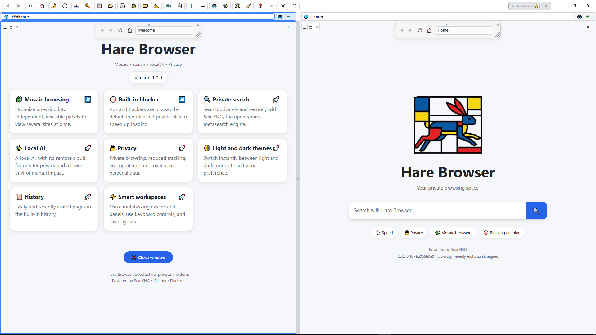
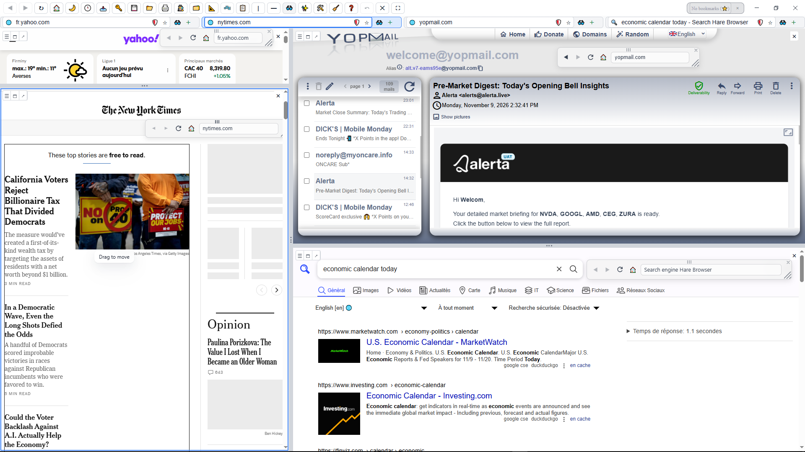
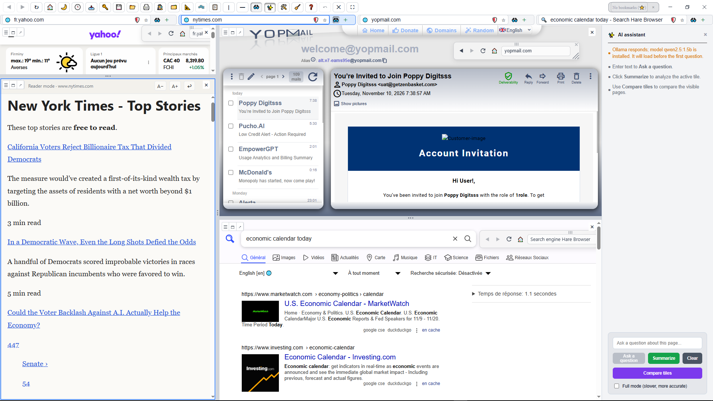

# Hare Browser

**[📥 Latest Release (v1.0.3)](https://github.com)** • **[📦 Download on SourceForge](https://sourceforge.net)** • **[📄 MIT License](LICENSE)**

**Hare Browser** is a privacy-focused multi-tile web browser for Windows and Linux, featuring split-view workspaces, a floating navigation bar, built-in ad/tracker blocking, and a local AI assistant powered by [Ollama](https://ollama.com).

---

## ✨ Features

- **Multi-Tile Mosaic Workspace:** Horizontal and vertical split views for side-by-side browsing.
- **Floating Navigation Bar & Session Management:** Clean per-tile controls with save/restore capabilities.
- **Local AI Assistant & Privacy:** Private browsing with integrated Ollama and ad/tracker blocking.
- **Smart Bookmarks & Themes:** Light and dark theme support with organized bookmarks.

---

## 📸 Screenshots

| Multi-Tile Mosaic Workspace | Local AI Assistant (Ollama) |
| :---: | :---: |
|  |  |

| Floating Navigation Bar & Themes |
| :---: |
|  |

---

## 📥 Download & Installation

Get official installers via **[GitHub Releases](https://github.com)** or **[SourceForge](https://sourceforge.netfiles/latest/download)**:

- **Windows (x64):** Download `Hare-Browser-Setup-1.0.3.exe` and run the installer.
- **Linux (Debian/Ubuntu/Mint):** Install via terminal with `sudo apt install ./Hare-Browser-1.0.3-amd64.deb`.
- **Linux (AppImage):** Make executable ( `chmod +x Hare-Browser-1.0.3-x86_64.AppImage` ) and run *(on Fedora/RHEL, install FUSE 2 first: `sudo dnf install fuse fuse-libs`)*.

---

## 🤖 Local AI & Development

- **Ollama Setup:** Hare Browser can automatically download, install, and start Ollama locally (`http://127.0.0.1:11434`) on both Windows and Linux without requiring `sudo`, or connect to an existing local instance.
- **Build from Source:** Requires Node.js 22+ and npm (`git clone https://github.com`, `npm install`, `npm start`).

---

## 📄 License

Licensed under the **MIT License** — see the [LICENSE](LICENSE) file for details.
